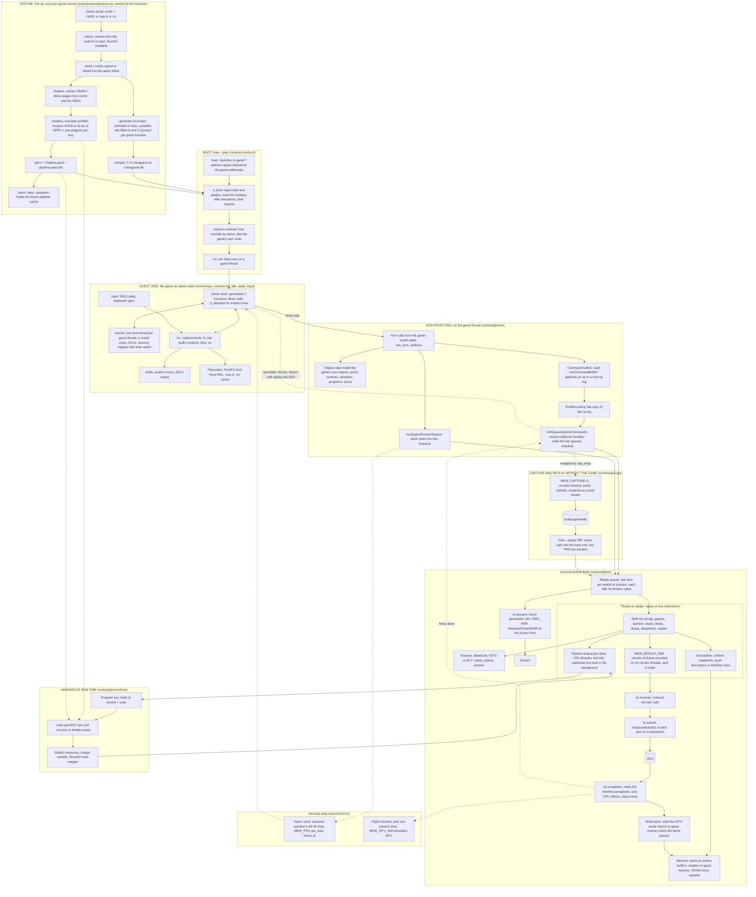

# Architecture

How mkw-recomp goes from a game dump to pixels on screen. One diagram of the whole process, then each part explained.
Paths are relative to the repo root. Details of a folder live in its own `README.md`.

## How to read it

Two worlds meet in the middle. The **guest** is the game's own code, translated to C ahead of time and running as a
normal native program. The **host** is everything the game used to get from the Switch 2 (kernel, SDK, GPU driver),
now written here. The only graphics API the game speaks is NVN2, so that is where the host takes over: nothing below it
emulates a GPU. There is no CPU interpreter or JIT anywhere.

## 1. Offline: Set up

Runs once per game version, from the launcher (the same `mkw` binary started without game code, `runtime/ui/launcher/`)
which starts `tools/prepare/prepare.py` as a child process and reads one event per line. Every step stores a key in
`setup-state.json`, so an interrupted setup resumes after the last finished step.

| Step | In | Out |
|---|---|---|
| check | a dump (loose `exefs/` + `romfs/`, a `.nup` or a `.nx`) | game version, from the build id of `exefs/main` (1.0.0 or 1.8.0); RomFS must hold at least 95 % of that version's files |
| exefs / romfs | the dump | copied into the game folder, or RomFS linked (a `.nup` is read in place) |
| generate | NSOs `main`, `subsdk0`, `sdk` (1.8.0 adds `subsdk1`) | C in chunks: one `void f_<addr>(Cpu *c)` per guest function plus a sorted address table, `layout.h`, `patches.h` |
| compile | that C | `mkwgame.so` / `mkwgame.dll` and its id |
| shaders | `romfs/Shader` and the NSOs | `spirv/<key>.{glsl,spv,res.json}`, `pipeline-pairs.bin`, `shaders.pack` |
| warm | `spirv/` and the pairs | the driver pipeline cache (`mkw --prewarm`, about a minute) |
| cleanup | | removes the work folder, keeps object caches |

- **Lifting** (`recomp/`): AArch64 to C, with jump tables and a patch file (spin loops, resolution, output, camera, LAN
  sets). Guest address equals host address: modules are placed at fixed addresses starting at `0x7000000000`
  (`recomp/layout.py`), so a guest pointer is a host pointer and loads and stores are plain memory accesses.
- **Shaders** (`sm86/`): the Switch 2 GPU is an Ampere (SM86). `sm86/spec/` builds the instruction spec from NVIDIA's
  `nvdisasm` and `ptxas` (downloaded at setup, never shipped); `tools/shaders/extract.py` pulls the stages out of the
  game; `tools/shaders/translate.py` decodes the machine code, emits GLSL (`sm86/translate/glsl`) and compiles it with
  shaderc to SPIR-V. A program is identified by a 32-byte hash of its control block and code, the same key the runtime
  computes later.
- **Textures** are not prepared at setup; an optional pre-pass (`mkw --texpre`) converts ASTC to BC7.

## 2. Boot

`main()` (`runtime/core/boot/main.c`) decides launcher or game, claims the address space at the guest addresses
(re-executing itself if something sits there), then calls `rt_boot()` (`boot.c`):

1. check `main.npdm` (priority, core, stack), start Discord presence;
2. start a prewarm thread that loads pipelines in parallel;
3. load native mod plugins (`runtime/plugin/`);
4. load every module: decompress segments into guest memory, apply relocations, seal the data;
5. register host overrides and seal the dispatch table;
6. open the window, then run `nn::init::Start` on a guest thread.

**Import resolution** order: observer, host override by name (`HOST_OVERRIDE`), the module's own definition, other
modules, weak = 0, and a strong import with no definition becomes a fatal stub. So the SDK is replaced by symbol name,
not by emulating service calls; the service IPC SVCs are fatal on purpose.

## 3. Guest side

- **Calls** (`runtime/cpu/dispatch.c`): a direct call is a plain C call to `f_<addr>`. An indirect call goes through
  `rt_dispatch`, a flat table with one entry per guest instruction slot. The `Cpu` struct holds registers; memory
  accesses are raw pointers.
- **Kernel** (`runtime/core/kernel/`): one guest thread is one host thread with its own `Cpu` and a 256 MiB reserved
  stack. There are 6 virtual cores; a thread holds one while it runs guest code and releases it at waits, sleeps and
  yields, with a preemption checkpoint in `rt_dispatch`. Fibers get a host fiber each. Waits use one global lock.
- **Memory** (`runtime/core/memory/`): regions are reservations committed in 4 KiB steps (stack and heap, alias, pool).
  Pages the CPU writes are watched and reported (`mem_written_pages`) so Vulkan re-uploads them; read traps deliver
  GPU writes back when the game touches a page.
- **SDK replacements** (`runtime/sdk/`): `nn::fs` (RomFS from files, `.nup` or `.nx`; saves), `nn::hid`, time, os.
- **Audio** (`runtime/audio/`): an `nn::audio` renderer; the `audren` thread mixes and plays through SDL3.
- **Input** (`runtime/input/`): SDL3 gamepads, keyboard and mouse remapping, gyro, plugged into the `nn::hid` shim.
- **Pacing** (`runtime/core/`): presents are counted as game time in 60 Hz ticks; `MKW_FPS` sets the game's present
  interval through its frame object, `fps_auto` picks interval 1 to 4 from the measured frame time, `frame_jit` delays
  the acquire so the frame starts late.

## 4. NVN front end (game thread)

`runtime/gfx/nvn/`. The game looks up `nvn*` functions through `nvnDeviceGetProcAddress`; the table
(`nvn/procs/nvn_procs.inc`) is registered as host overrides and answered by `bsearch`. NVN2-only entries are in
`nvn2_procs.inc` (mesh, push constants, ray tracing and VRS are dropped with a warning). Calls run on the game thread
that makes them.

- **Objects** live inside the game's own objects (`nvn/api/nvn_obj.h` checks that each struct fits). A texture carries a
  `serial`, because the game copies the object by value and the back end needs a stable identity.
- **Recording**: a command buffer is a host op log of `{op, size}` headers plus payloads (`SET_RT`, `BIND_PROGRAM`,
  `BIND_UBO`, `DRAW`, `DISPATCH`, copies, barriers, events...). The game's command memory is only counted, never
  written. `EndRecording` makes a flat copy; `CallCommands` copies the called log inline.
- **Submit** (`nvnQueueSubmitCommands`): handles of textures and samplers are stored as pointers into the game's
  arrays and read here (`resolve_deferred`); GPU writes to CPU-visible memory and events are listed; a submit that hits
  an unmet `WAIT_EVENT` of the other queue is held in place (`nvn_qorder`) so the two queues keep their order. Then the
  submit is enqueued and returns a fence.
- **Sync**: `nvnSyncWait` compares with the back end's fence and blocks otherwise; `nvnQueueFinish` drains. The game
  runs at most one frame ahead: enqueuing present N waits for the replay of N-1.
- **Present**: `nvnWindowAcquireTexture` blocks until the slot is free; `nvnQueuePresentTexture` picks the slot with the
  pacer and enqueues.
- The back end is chosen in `gfx_backend()`: `MKW_GPU=null`, or the Vulkan back end wrapped by the capture layer.

## 5. Vulkan back end

`runtime/gfx/vk/`. By default submit and present only **enqueue** an item with its timeline value; everything else
happens on other threads.

| Thread | Does |
|---|---|
| `vk replay` | takes items in order, records each submission (`vk_exec_record`), uploads, sends |
| `vk chunks` | records chunks of draws in parallel (`MKW_REPLAY_PAR`) |
| `vk recorder` | makes the ordered `vkCmd*` calls from a ring |
| `vk submit` | `vkQueueSubmit2` of each part of a submission |
| `vk completion` | waits the timeline semaphore, runs CPU effects (events, counters, write-backs), raises `done` |
| `vk present`, `vk flip` | frame generation, blit, `vkQueuePresentKHR` held until the screen time |
| `vk shadow`, `vk wb par` | shadow copies and write-back in parallel |
| `pipe worker`, `pipe prewarm`, `pipe lib` | pipeline builds |

**Replaying a submission.** `vk_exec_record` walks the op log (jumps and calls followed) and turns each op into Vulkan:
render passes (`vkCmdBeginRendering`), barriers, clears, binds, draws, dispatches, copies, events, counters and
conditional rendering (decided on the CPU while recording). A submission is cut into **parts** (every 64 draws or 2 ms)
so the GPU can start before the end; only the last part signals the submission's value. With `MKW_REPLAY_PAR` a light
pass cuts **chunks** of draws that other threads record, and the replay thread sends them in order.

**Descriptors.** Uniform buffers are copied as snapshots when recording starts, and the replay uses the copy. Bindings go
by push descriptors by default; `MKW_DRAW_CACHE=1` uses dynamic offsets. `MKW_BINDLESS=1` (off by default, needs
`SM86_BINDLESS` programs) replaces the descriptors with per-draw rows of buffer addresses and, at level 2, texture
indices into one global descriptor set, so a recorded command buffer no longer depends on per-draw values.

**Pipelines** (`pipe/`). A draw asks `vk_pipeline_graphics_async`. Graphics pipeline libraries (vertex input,
pre-raster, fragment shader, fragment output) are cached by their part of the state key and linked fast on the spot; a
worker builds the optimized monolithic pipeline in the background and replaces it. While a pipeline is not ready the
draw is skipped, except in a few cases that wait. The pipeline cache and the key and pair lists from setup feed the
prewarm.

**Memory** (`mem/`). NVN pools are Vulkan buffers; the address of a resource resolves to (buffer, offset).
- *Shadow*: a copy of guest memory made before each submit, by dirty page generation; `vk shadow` can run it early.
- *VRAM mirror*: on a discrete GPU the pool is copied to a local buffer the first time it is used, in a prologue
  command buffer sent before the part that needs it.
- *Write-back*: what the GPU writes is marked when recording and copied to guest memory when the fence passes
  (`MKW_WB_ORDER` holds a part that rewrites a page with a write-back pending).
- *Zero-copy* through udmabuf exists but is off by default.

**Textures** (`tex/`). Deswizzle on the CPU and staging upload; ASTC native when the device supports it, otherwise
decoded by compute, and large ASTC can go to BC7; sparse textures bind tiles on `MapVirtual`; eviction under memory
pressure. Lock order: `tex_lock`, `slots_lock`, `view_lock`.

**Presentation.** `present_image` hands the game's image to `vk present`, which runs frame generation, the blit (FSR 1,
HDR10, the F1 menu), an empty submit for the present value, then waits for the screen time and calls
`vkQueuePresentKHR`. DLSS and FSR 3 hook the draw and the jittered viewport in `exec/vk_temporal.c`.

**Where one waits for another** (the serial chain the performance work targets):
game to replay (queue full, the one-frame limit, blocking calls such as map or finish), replay to chunks (it stops at
the first one not ready), replay to pipelines, replay to the previous write-back, and GPU to CPU (`done` rises only
after the CPU effects ran, which is what the game's fence waits see).

## 6. Shaders at run time

The replay asks `gfx_shader_get(control, code)`. The key is the same hash the translator used. `prepared_get` looks in
memory, then loads `spirv/<key>.spv` and `.res.json`, or `shaders.pack`; then it reflects the resources and applies the
integer variants and the RenoDX tone mapper. An unknown program is logged (`no prepared SPIR-V`) and the draws that use
it are skipped, not fatal; the miss is cached.

## 7. Capture and replay without the game

`MKW_CAPTURE=1` wraps the back end from boot (`runtime/gfx/cap/`) and records a zstd stream of records (memory pages,
pool init, mappings, texture and sampler registrations, submits, presents, finishes). `mkw --replay DIR` restores the
memory at its addresses, hands the pools and slots back to the back end and replays every call in order, writing one PNG
per present. A change to the back end (replay, translator output, textures, memory) can be checked in seconds this way,
and compared image by image against another replay (`tools/test/replay.sh`, `tools/imagen/dircmp.py`).

## 8. Diagnostics

`runtime/core/diag/`: a flight recorder, `perf`, per-present rows, and sequence watching by game phase.
`MKW_TRACE=perf` and GPU timestamps measure each part; `MKW_DUMP` writes a frame as PNG; `MKW_GPU_SIM` does not run
the command buffers at all: a submission finishes when a simulated GPU of N ms per 1000 draws would have finished it,
which lets the CPU side of the pipeline be measured independently of the machine's real GPU.
